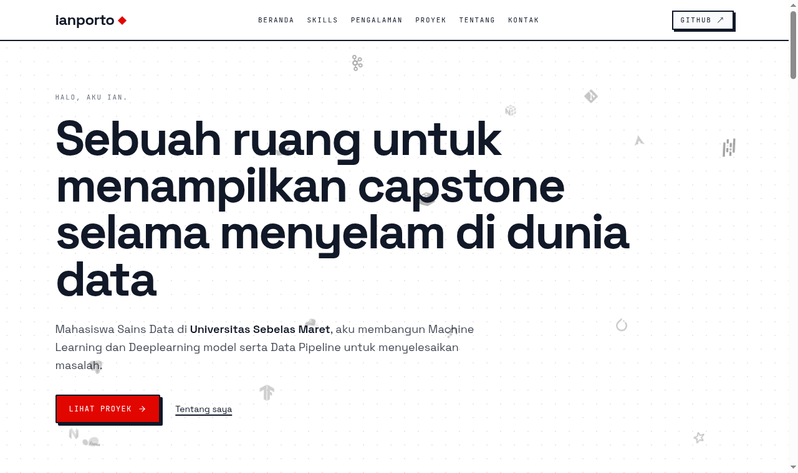

[](https://iaanne.github.io/portfolio/)

**Live:** https://iaanne.github.io/portfolio/

# Portofolio Ian

Situs portofolio statis: React 19, Vite, Tailwind v4, React Router.

## Menjalankan

```bash
npm install
npm run dev
```

## Build

```bash
npm run build
```

Hasilnya di `dist/`. Skrip build juga menyalin `index.html` menjadi `404.html`, supaya tautan dalam seperti `/proyek/slug` tetap terbuka di hosting yang tidak punya rewrite SPA.

## Deploy

Setiap push ke `main` memicu workflow `.github/workflows/deploy.yml` yang membangun situs lalu menerbitkannya ke GitHub Pages.

## Isi

- `src/data/projects.ts` - delapan proyek pilihan, ringkasan dan stack.
- `src/data/skills.ts` - daftar skill per kategori, dipakai bagian Skills dan animasi di beranda.
- `src/assets/profile.jpg` - foto profil di beranda.
- `src/assets/brand/` - logo merek berwarna untuk setiap ikon skill.
- `src/pages/Home.tsx` - beranda, skill, pengalaman, proyek, tentang, kontak.
- `src/pages/ProjectPage.tsx` - halaman detail per proyek.

Semua teks ada di berkas data itu dan di halaman, jadi sunting langsung tanpa menyentuh gaya.
